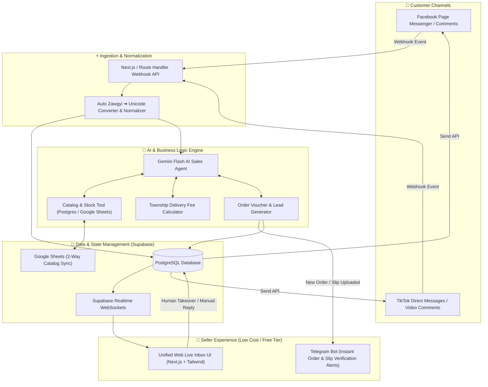

# 🚀 Myanmar AI Social Commerce Hub: Unified Facebook & TikTok Inbox

A low-cost, AI-automated social commerce platform tailored specifically for online shops in **Myanmar**, centralizing customer conversations from **Facebook Messenger** and **TikTok Shop/Direct Messages**, with intelligent Burmese-language automated selling, real-time stock/price checking via Google Sheets sync, and instant Telegram order alerts.

---

## 🏗️ 1. System Architecture Overview



---

## 🎯 2. Core Features Tailored for the Myanmar Market

| Feature | Description | Myanmar Market Fit |
| :--- | :--- | :--- |
| **Unified Multi-Channel Inbox** | Connect multiple Facebook Pages and TikTok accounts into a single live chat interface. | Eliminates switching between Meta Business Suite and TikTok app. |
| **Zawgyi & Unicode Dual Support** | Auto-detects legacy Zawgyi encoding and converts to standard Unicode before AI processing; replies in clean Unicode. | Prevents broken font errors for older customer devices. |
| **Burmese Polite Sales Tone** | System-prompted with local business etiquette (`ရှင်` / `ခင်ဗျာ`), handling colloquial phrases (`instock shi lr`, `deli bl lout ll`). | Delivers a warm, natural shop assistant persona. |
| **Google Sheets 2-Way Sync** | Live product catalog (Name, Photo, Price, Stock count, Variants) synced automatically with seller's Google Sheets. | Zero learning curve for sellers already tracking stock in Sheets. |
| **Township Delivery & Gate Calculator** | Pre-configured delivery matrices for Yangon (45+ townships), Mandalay, and regional highway express delivery gates. | Handles standard Myanmar COD and deli fee inquiries instantly. |
| **KPay / WavePay / COD Order Flow** | AI collects: Name, Phone (09-xxx), Township, Address, Payment preference; creates a draft order voucher. | Speeds up checkout and minimizes back-and-forth messaging. |
| **Instant Telegram Seller Alerts** | Sends instant push notification with customer order details & payment slip to seller's Telegram. | 100% free push alerts without costly SMS or dedicated mobile app maintenance. |
| **Seamless Human Takeover** | One-click toggle in the inbox to pause AI responses for specific customers requiring manual attention. | Ensures complex disputes or VIP customers receive personal care. |

---

## 💰 3. Ultra-Low Cost Infrastructure Breakdown

Estimated operating cost for **10 to 50 active online shops**:

| Component | Technology | Free Tier / Monthly Cost | Notes |
| :--- | :--- | :--- | :--- |
| **Web Frontend & API** | Next.js 15 (App Router) on Vercel / Cloudflare | **$0 / month** (Hobby Tier) | Unlimited edge requests for low-to-medium traffic. |
| **Database & Realtime** | Supabase (PostgreSQL + Realtime) | **$0 / month** (Free Tier: 500MB DB, 50k MAU) | Easily holds 100,000+ chats and products. |
| **AI LLM Engine** | Google Gemini 2.5 / 3.0 Flash API | **~$0.50 – $3.00 / month** | \$0.075 / 1M input tokens. Extremely affordable Burmese processing. |
| **Push Notifications** | Telegram Bot API | **$0 / month** (Unlimited Free) | Instant real-time alerts directly on seller's phone. |
| **Catalog Storage** | Google Sheets API (v4) | **$0 / month** (Free via Google Cloud Console) | Free 2-way sync using service accounts. |
| **Total Estimated Cost** | — | **< $5.00 / month** | **Near-zero overhead!** |

---

## 🗄️ 4. Core Database Schema (Supabase / Postgres)

```sql
-- Shops / Tenants
CREATE TABLE shops (
    id UUID PRIMARY KEY DEFAULT gen_random_uuid(),
    name TEXT NOT NULL,
    owner_email TEXT NOT NULL,
    telegram_chat_id TEXT,
    google_sheet_id TEXT,
    created_at TIMESTAMPTZ DEFAULT now()
);

-- Channel Integrations (FB Page / TikTok)
CREATE TABLE channel_connections (
    id UUID PRIMARY KEY DEFAULT gen_random_uuid(),
    shop_id UUID REFERENCES shops(id) ON DELETE CASCADE,
    platform TEXT NOT NULL CHECK (platform IN ('facebook', 'tiktok')),
    page_id TEXT NOT NULL,
    access_token TEXT NOT NULL,
    webhook_secret TEXT,
    is_active BOOLEAN DEFAULT true
);

-- Products & Inventory
CREATE TABLE products (
    id UUID PRIMARY KEY DEFAULT gen_random_uuid(),
    shop_id UUID REFERENCES shops(id) ON DELETE CASCADE,
    sku TEXT,
    name TEXT NOT NULL,
    description TEXT,
    price_mmk NUMERIC NOT NULL,
    stock_quantity INTEGER NOT NULL DEFAULT 0,
    image_url TEXT,
    category TEXT,
    is_available BOOLEAN DEFAULT true,
    updated_at TIMESTAMPTZ DEFAULT now()
);

-- Customer Conversations & Threads
CREATE TABLE conversations (
    id UUID PRIMARY KEY DEFAULT gen_random_uuid(),
    shop_id UUID REFERENCES shops(id) ON DELETE CASCADE,
    platform TEXT NOT NULL,
    customer_platform_id TEXT NOT NULL,
    customer_name TEXT,
    ai_status TEXT DEFAULT 'auto' CHECK (ai_status IN ('auto', 'paused', 'human_takeover')),
    last_message_at TIMESTAMPTZ DEFAULT now(),
    UNIQUE(shop_id, platform, customer_platform_id)
);

-- Messages Log
CREATE TABLE messages (
    id UUID PRIMARY KEY DEFAULT gen_random_uuid(),
    conversation_id UUID REFERENCES conversations(id) ON DELETE CASCADE,
    sender_type TEXT NOT NULL CHECK (sender_type IN ('customer', 'ai', 'human_agent')),
    raw_content TEXT NOT NULL,
    normalized_content TEXT NOT NULL, -- Unicode converted
    media_url TEXT,
    created_at TIMESTAMPTZ DEFAULT now()
);

-- Orders Captured by AI
CREATE TABLE orders (
    id UUID PRIMARY KEY DEFAULT gen_random_uuid(),
    shop_id UUID REFERENCES shops(id) ON DELETE CASCADE,
    conversation_id UUID REFERENCES conversations(id),
    customer_name TEXT NOT NULL,
    customer_phone TEXT NOT NULL,
    township TEXT NOT NULL,
    full_address TEXT NOT NULL,
    items JSONB NOT NULL, -- [{product_id, name, qty, price}]
    subtotal_mmk NUMERIC NOT NULL,
    delivery_fee_mmk NUMERIC DEFAULT 0,
    total_mmk NUMERIC NOT NULL,
    payment_method TEXT CHECK (payment_method IN ('kpay', 'wavepay', 'cod', 'cbpay', 'ayapay')),
    payment_slip_url TEXT,
    status TEXT DEFAULT 'pending_slip' CHECK (status IN ('pending_slip', 'pending_approval', 'confirmed', 'shipped', 'cancelled')),
    created_at TIMESTAMPTZ DEFAULT now()
);
```

---

## 🛠️ 5. Step-by-Step Implementation Roadmap

### **Phase 1: Project Setup & Core Foundation**
- [ ] Initialize Next.js 15 app with TypeScript, Tailwind CSS, and Lucide icons.
- [ ] Setup Supabase project, run database schema migrations, and enable Realtime on `messages` & `conversations`.
- [ ] Implement Zawgyi/Unicode font converter utility (e.g., `rabbit-node` or `knconverter`).

### **Phase 2: Product & Inventory Engine (Google Sheets Sync)**
- [ ] Build Product Catalog CRUD in Next.js web dashboard.
- [ ] Implement Google Sheets API v4 integration for automated 2-way synchronization of stock and prices.
- [ ] Add Delivery Fee configuration table (Townships & Rates in MMK).

### **Phase 3: AI Agent & Multi-Channel Webhooks**
- [ ] Setup Meta Messenger Graph API Webhook endpoint with signature verification (`sha256`).
- [ ] Setup TikTok Webhook receiver for messages/comments.
- [ ] Build the Gemini Flash Agent with function calling:
  - `check_stock_and_price(product_name_or_keyword)`
  - `calculate_delivery_fee(township_name)`
  - `create_order_voucher(customer_info, items, payment_method)`
- [ ] Craft the Burmese Sales System Prompt with polite closing techniques (`ရှင်/ခင်ဗျာ`).

### **Phase 4: Unified Live Inbox UI & Seller Notification**
- [ ] Build split-pane Unified Inbox (Left: conversation list; Center: live chat; Right: customer order & quick catalog panel).
- [ ] Implement Telegram Bot webhook service to send instant order alerts + slip preview to shop owners.
- [ ] Add one-click "Take Over / Handover to Human" toggle button.

### **Phase 5: Testing & Deployment**
- [ ] Test end-to-end flow with simulated Facebook & TikTok test webhooks.
- [ ] Verify Burmese slang/colloquial understanding and stock deduction accuracy.
- [ ] Deploy frontend/API to Vercel and configure domain.
