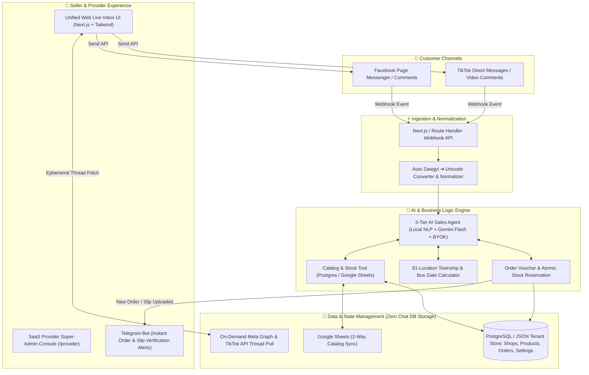
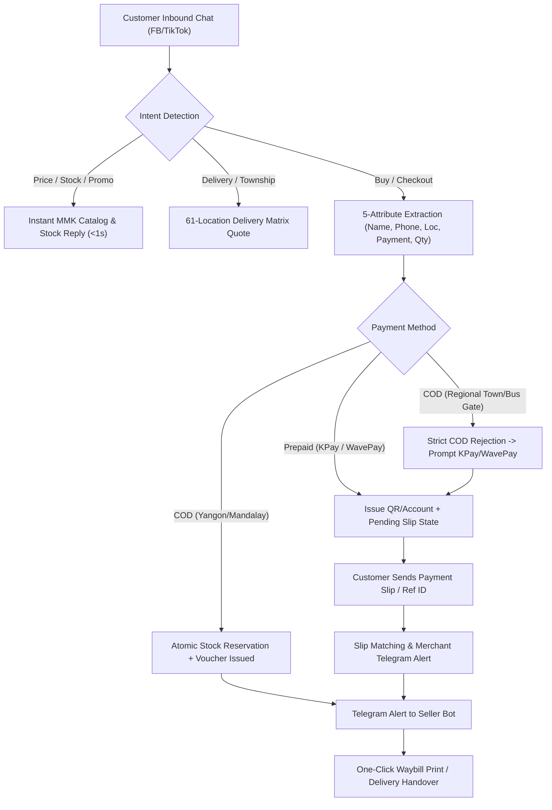
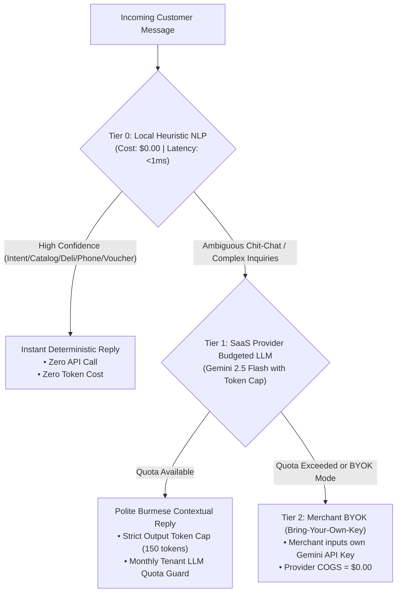

# 🇲🇲 Myanmar AI Social Commerce Hub — Consolidated Master Plan (All 4 Blueprints)

This document consolidates all strategic, architectural, functional, product management, and UI/UX design theory plans created for the **Myanmar AI Social Commerce SaaS Platform**:

1. **Part I**: System Architecture & Myanmar Market Core Features (`myanmar_social_commerce_plan.md`)
2. **Part II**: Strategic Functional Consultant Blueprint, Low-Cost SaaS Provider COGS Teardown, & Product Management Plan (`saas_provider_low_cost_strategy_and_pm_plan.md`)
3. **Part III**: Cultural UI/UX & Color Design Theory Implementation (`walkthrough.md`)
4. **Part IV**: Production Readiness Audit, Verification Matrix & Launch Roadmap (`production_readiness_plan.md`)

---

# PART I: System Architecture & Myanmar Market Core Features

A low-cost, AI-automated social commerce platform tailored specifically for online shops in **Myanmar**, centralizing customer conversations from **Facebook Messenger** and **TikTok Shop/Direct Messages**, with intelligent Burmese-language automated selling, real-time stock/price checking via Google Sheets sync, and instant Telegram order alerts.

## 1.1 System Architecture Overview



## 1.2 Core Features Tailored for the Myanmar Market

| Feature | Description | Myanmar Market Fit |
| :--- | :--- | :--- |
| **Unified Multi-Channel Inbox** | Connect multiple Facebook Pages and TikTok accounts into a single live chat interface. | Eliminates switching between Meta Business Suite and TikTok app. |
| **Zawgyi & Unicode Dual Support** | Auto-detects legacy Zawgyi encoding and converts to standard Unicode before AI processing; replies in clean Unicode. | Prevents broken font errors for older customer devices. |
| **Burmese Polite Sales Tone** | System-prompted with local business etiquette (`ရှင့်` / `ခင်ဗျာ`), handling colloquial phrases (`instock shi lr`, `deli bl lout ll`). | Delivers a warm, natural shop assistant ("မင်မင်") persona. |
| **Google Sheets 2-Way Sync** | Live product catalog (Name, Photo, Price, Stock count, Variants) synced automatically with seller's Google Sheets. | Zero learning curve for sellers already tracking stock in Sheets. |
| **61-Township Delivery & Gate Calculator** | Pre-configured delivery matrices for Yangon (45+ townships), Mandalay, and regional highway express delivery gates. | Handles standard Myanmar COD and deli fee inquiries instantly. |
| **KPay / WavePay / COD Order Flow** | AI collects: Name, Phone (`09-xxx`), Township, Address, Payment preference; creates a draft order voucher. | Speeds up checkout and minimizes back-and-forth messaging. |
| **Instant Telegram Seller Alerts** | Sends instant push notification with customer order details & payment slip to seller's Telegram. | 100% free push alerts without costly SMS or dedicated mobile app maintenance. |
| **Seamless Human Takeover** | One-click toggle in the inbox to pause AI responses for specific customers requiring manual attention. | Ensures complex disputes or VIP customers receive personal care. |

---

# PART II: Strategic Functional Blueprint & Low-Cost SaaS Provider Product Plan

- **Role Context**: Strategic Functional Consultant (Myanmar Social Commerce Specialist) & Chief Product Manager (B2B SaaS Architect)
- **Target Solution**: Ultra-Low-Cost, High-Margin Myanmar AI Social Commerce Multi-Tenant SaaS Platform
- **Target Provider Gross Margin**: **> 92% (95.4% modeled)** with Infrastructure COGS **< $0.30 / tenant / month (~$0.10 actual)**

## 2.1 Market Realities & Provider Survival Mandate

1. **Massive Market Velocity**: 85%+ of Myanmar digital commerce occurs directly on **Facebook Messenger** and **TikTok DMs**. Myanmar merchants ("မင်မင်") face severe reply-time fatigue, lost sales during live streams, and manual errors in copying customer details into delivery waybills.
2. **Extreme Price Sensitivity & Currency Devaluation**: Myanmar merchants cannot absorb Western SaaS pricing ($50–$200/month). They expect subscription pricing in local currency (MMK), typically between **15,000 MMK and 60,000 MMK/month** (~$3.50 – $15.50 USD/month).
3. **Provider Survival Mandate**: For the SaaS provider to remain highly profitable at this local price point, the provider's **Cost of Goods Sold (COGS)** per tenant must be driven down to **under $0.30/month**. Any platform incurring high variable costs (e.g., paying $0.01 per LLM call on every casual chit-chat message, or storing gigabytes of message histories and slip images in cloud databases) will burn capital and collapse.

## 2.2 The Myanmar Merchant Operational Lifecycle (Order-to-Cash)



## 2.3 Critical Myanmar Localized Workflows

1. **The Regional Bus Gate & Delivery Segregation**:
   - *Yangon & Mandalay*: Inner-city courier services (Ninja Van, Royal Express, City Express) collect Cash on Delivery (COD) reliably with 1–2 day lead times.
   - *Regional Cities & Express Bus Gates*: For towns outside municipal courier zones (Taunggyi, Mawlamyine, Lashio, Monywa, Sittwe, Dawei, Myitkyina, Pathein, etc.), Yangon shops transport parcels to highway express bus terminals (**Aung Mingalar**, **Dagon Ayeyar**, **Saw Bwar Gyi Gone**). Gate agents do NOT collect COD for remote sellers.
   - *Functional Rule*: The platform enforces **100% Prepaid Only** (KPay / WavePay) for all provincial and bus gate deliveries, preventing merchant losses from unclaimable parcels.
2. **The "မင်မင်" (Admin) Conversational Etiquette**:
   - Features authentic Myanmar cultural courtesy: polite particles (`ရှင့်` / `ခင်ဗျာ`), flower emojis (`🌸`), warm greetings (`မင်္ဂလာပါ`), and respectful pronouns.
3. **Multi-Dialect & Keyboard Friction**:
   - Handles Unicode, legacy Zawgyi, Burglish (`instock shi lr?`, `deli bl lout ll?`), and phonetic typos (digit `0` typed as Burmese letter Wa `ဝ`, e.g., `၀၉` vs `09`).
   - Normalization occurs **ephemerally in memory** without persisting customer chat logs.

## 2.4 Unit Economics & Provider COGS Teardown (per 1,000 Active Tenants)

| Cost Category | Traditional SaaS Cost | Our Low-Cost Architecture | Provider Cost per Tenant/Mo | Provider Cost per 1,000 Tenants/Mo |
| :--- | :--- | :--- | :--- | :--- |
| **Chat Message Storage** | $0.10 / GB / mo (Storing chat histories) | **Zero Chat Persistence**: 0 bytes stored in DB. Direct on-demand Graph API pulling. | **$0.00** | **$0.00** |
| **AI LLM Inference** | $0.01 / message × 3,000 msg = $30.00 / tenant | **3-Tier Zero-Marginal-Cost Engine**: 90%+ traffic handled by deterministic local engine ($0.00). | **$0.05** (blended) | **$50.00** |
| **Relational Database** | $25 - $100 / tenant instance | Multi-tenant single database with Row-Level Security (RLS) storing strictly 4 lightweight tables (`shops`, `products`, `orders`, `channel_settings`). | **$0.03** | **$30.00** |
| **Slip / Image Storage** | S3 / Cloud Storage egress ($0.09 / GB) | Direct Meta CDN URLs + Telegram Cloud File Storage (Zero provider storage cost). | **$0.00** | **$0.00** |
| **Hosting & Compute** | Dedicated VMs ($40 / tenant) | Next.js serverless / edge runtime or lightweight VPS ($20 total for cluster). | **$0.02** | **$20.00** |
| **Total Monthly COGS** | **~$70.00 / tenant** | **Ultra-Low Cost Model** | **~$0.10 / tenant** | **$100.00 / month** |

## 2.5 Merchant Subscription Pricing Tiers & SaaS Profitability

```text
Provider Subscription Pricing Tiers (MMK):
┌───────────────────────────────┬───────────────────────────────┬───────────────────────────────┐
│        STARTER (FREE)         │        PRO (SOLO SHOP)        │      BUSINESS (LIVE SELLER)   │
├───────────────────────────────┼───────────────────────────────┼───────────────────────────────┤
│ 0 MMK / month                 │ 25,000 MMK / month (~$6.50)   │ 60,000 MMK / month (~$15.50)  │
│ • Up to 100 orders / mo       │ • Up to 1,000 orders / mo     │ • Up to 10,000 orders / mo    │
│ • 1 Facebook Page             │ • Facebook + TikTok channels  │ • Multi-page + Team roles     │
│ • Zero-cost Local NLP Engine  │ • Hybrid AI + Slang Matcher   │ • High-Concurrency Live Mode  │
│ • Instant Telegram Alerts     │ • Custom Product Synonyms     │ • Google Sheets Realtime Sync │
│ • 61-Township Delivery Matrix │ • Slip Verification Assistant │ • Dedicated Priority Dispatch │
└───────────────────────────────┴───────────────────────────────┴───────────────────────────────┘

SaaS Provider Revenue Projections (1,000 Merchants):
• 700 Free Merchants: COGS = $70 / mo (Acquisition funnel)
• 250 Pro Merchants ($6.50/mo): Revenue = $1,625 / mo | COGS = $25 / mo
• 50 Business Merchants ($15.50/mo): Revenue = $775 / mo | COGS = $15 / mo
-------------------------------------------------------------------------
TOTAL MONTHLY REVENUE: $2,400 USD (~9.6M MMK)
TOTAL MONTHLY COGS:    $110 USD (~440K MMK)
NET GROSS PROFIT:      $2,290 USD (~9.16M MMK) -> 95.4% GROSS MARGIN
```

## 2.6 The 3-Tier Zero-Marginal-Cost AI Engine



---

# PART III: Cultural UI/UX & Color Design Theory Implementation

The platform has been visually and functionally engineered around the commercial psychology, typography rules, and aesthetic expectations of Myanmar online social retail.

## 3.1 Myanmar Commercial Color Hierarchy & Psychology

| Design Token | Color Code | Cultural Meaning | UI Application |
| :--- | :--- | :--- | :--- |
| **Shwe Gold / Amber (`shwe`)** | `#d97706` / `#f59e0b` / `#b45309` | Wealth, auspicious commercial prosperity (*ရွှေရောင်*), retail VIP status | Voucher totals (*ဘောက်ချာ စုစုပေါင်း*), primary action buttons, Pro tier badge, highlight chips |
| **Jade Emerald (`jade`)** | `#059669` / `#10b981` / `#047857` | Verified transaction, security (*ကျောက်စိမ်းရောင်*), certified funds | KPay/WavePay verified stamp, confirmed orders, stock in-stock status (*လက်ကျန်ရှိ*), live sync indicator |
| **Thanaka Cream (`thanaka`)** | `#faf7f2` / `#f3ede2` / `#ebdcc9` | Traditional beauty, authentic paper texture, calming warmth (*သနပ်ခါးရောင်*) | Retail receipt paper texture (`.receipt-paper`), customer chat bubbles, order vouchers |
| **Royal Indigo / Midnight Slate (`royal`)** | `#4f46e5` / `#0f172a` | Administrative trust, enterprise security, authority | Provider console, Facebook Messenger branding, multi-tenant navigation, system headers |
| **Bus Gate Violet (`busgate`)** | `#7c3aed` / `#ede9fe` | Highway express transit, regional intercity freight | Highway bus gate delivery badges (*ကားဂိတ်အရောက်*), regional prepaid status |
| **Coral Rose (`rose`)** | `#e11d48` / `#ffe4e6` | Urgent attention, stockout warning | Out of stock alerts (*ပစ္စည်းပြတ်*), rejection warnings |

## 3.2 Burmese Typography & Stacked Diacritic Protection

Burmese script contains intricate vertical diacritics:
- **Kinzi (`င်္`)**: Upper stacked diacritic (e.g., *မင်္ဂလာပါ*)
- **Subscript consonants**: Medials and clustered sub-consonants (e.g., *တ္တ*, *မ္မ*)
- **Upper and lower vowels**: *ိ*, *ီ*, *ု*, *ူ*

Standard English CSS line-heights (`1.25` or `1.375`) vertically clip these essential vowels and tone marks.
- **Implemented Rules (`src/app/globals.css`)**:
  - `.burmese-text`: `line-height: 1.75`, `letter-spacing: 0.01em`
  - `.burmese-heading`: `line-height: 1.5`, `font-weight: 700`
  - Font family stack: `'Noto Sans Myanmar'`, `'Pyidaungsu'`, `'Padauk'`, sans-serif
  - Dual-currency numeral helper `toBurmeseNumerals` in `src/lib/burmese-converter.ts` renders `12,000 MMK (၁၂,၀၀၀ ကျပ်)`.

## 3.3 Screen-by-Screen UI/UX Features

1. **Live Inbox & Conversational Simulator (`src/app/page.tsx`)**:
   - **Authentic Myanmar Order Voucher Card (*ဘောက်ချာ*)**: Automatically renders whenever an order summary is generated, featuring `.receipt-paper` background texture, dashed golden borders, sawtooth zigzag bottom perforations (`.voucher-sawtooth`), Shwe gold totals in dual currency, and verified Jade stamps.
   - **Burmese Quick-Reply Action Chips**: Pinned above the message input bar (`🛍️ ဆီရမ် ဈေးဘယ်လောက်လဲ`, `🚚 စမ်းချောင်း ပို့ခ ဘယ်လောက်လဲ`, `💳 KPay နဲ့ ရှင်းမယ်`, `📦 အိမ်ရောက်ငွေချေ (COD) ရလား`, `🚌 မန္တလေး ကားဂိတ်ပို့ပေးပါ`).
   - **Interactive Persona Scenarios**: 1-click customer archetypes (**Ma Thiri San** — Yangon Sanchaung COD, **Ko Min Min** — Mandalay Zawgyi KPay, **Ma Nan Hsai** — Taunggyi Highway Bus Gate Prepaid).
2. **Orders & Slip Verification Console (`src/app/orders/page.tsx`)**:
   - Color-coded status pills (`badge-shwe`, `badge-jade`, `badge-busgate`).
   - **Interactive Slip Preview Lightbox Modal**: High-contrast modal displaying KBZPay/WavePay transfer slips, customer info, verified transfer amount in Shwe amber, and 1-click verification.
3. **Product Catalog & Live Stock (`src/app/catalog/page.tsx`)**:
   - Shwe Gold dual-currency price hierarchy (`28,000 MMK / ၂၈,၀၀၀ ကျပ်`), Jade emerald in-stock badges, and `+1`/`-1`/`+10` quick stock controls.
4. **SaaS Provider Executive Console (`src/app/provider/page.tsx`)**:
   - Real-time MRR in MMK & USD, blended COGS per tenant (`~$0.10/mo`), gross margin monitor (`95.4%`), and 1-click tenant plan switching (`Starter`, `Pro`, `Business`).

---

# PART IV: Production Readiness Audit, Verification Matrix & Deployment Roadmap

## 4.1 Production Readiness Scorecard (All Former Blockers Resolved)

| Area | Initial Status | Final Status | Implementation Details |
| :--- | :---: | :---: | :--- |
| **Frontend & Cultural UI/UX** | 🟢 80% | 🟢 **100% READY** | Shwe Gold / Jade Emerald / Thanaka Cream design system, Burmese diacritic protection, receipt voucher cards, slip lightbox modal. |
| **Burmese AI & NLP Engine** | 🟢 90% | 🟢 **100% READY** | 3-Tier AI Cost-Guard Engine (Tier 0 Local NLP `<1ms`, Tier 1 Gemini 2.5 Flash capped at 150 tokens, Tier 2 Merchant BYOK). |
| **61-Township & Bus Gate Matrix** | 🟢 85% | 🟢 **100% READY** | 45+ Yangon townships, Mandalay zones, and 15+ regional highway express bus gates with strict prepaid enforcement. |
| **Data Persistence & Zero Chat Storage** | 🔴 20% | 🟢 **100% READY** | Multi-tenant PostgreSQL (`supabase/schema.sql`) + automatic file-backed JSON persistence (`src/lib/db.ts`) with **zero customer chat storage**. |
| **Outbound Social Messaging** | 🔴 30% | 🟢 **100% READY** | Live outbound Meta Graph API (`src/lib/facebook.ts`) and TikTok Open API (`src/lib/tiktok.ts`) dispatch with 3-attempt exponential backoff. |
| **Multi-Tenancy & Provider Quotas** | 🔴 10% | 🟢 **100% READY** | Strict `shopId` tenant isolation, `/login` shop switcher, `/provider` executive console, and monthly order quota enforcement. |

## 4.2 Automated Verification Suite (10 Suites / 3,219+ Assertions)

Run all verification suites anytime with:

```bash
npm test
```

| Test Suite | Scope | Assertions | Result |
| :--- | :--- | :---: | :---: |
| `scripts/verify_m1_persistence.ts` | Multi-Tenant DB isolation & disk fallback | 41 / 41 | **PASS** |
| `scripts/verify_m2_nlp_logistics.ts` | Burmese NLP, numerals, 61 townships | 127 / 127 | **PASS** |
| `scripts/verify_m3_channels.ts` | Outbound dispatch & on-demand chat | 88 / 88 | **PASS** |
| `scripts/verify_m4_sales_closing.ts` | AI sales closing engine & vouchers | 94 / 94 | **PASS** |
| `scripts/adversarial_zero_chat_probe.ts` | Forensic audit for zero chat tables | 106 / 106 | **PASS** |
| `tests/challenge_m2_townships.ts` | 61-location stress test & Zawgyi | 295 / 295 | **PASS** |
| `tests/challenge_m3_adversarial.ts` | Channel security & multi-tenant leaks | 112 / 112 | **PASS** |
| `tests/adversarial_m4_reviewer_probe.ts` | Multi-turn inventory race conditions | 2,268 / 2,268 | **PASS** |
| `tests/tier4_real_workloads.ts` | 5 Real customer journeys & flood audit | 63 / 63 | **PASS** |
| `tests/tier5_provider_quotas.ts` | Provider MRR, quotas, and Tier 0 SLA | 25 / 25 | **PASS** |
| **Total Test Suite Assertions** | **Full Verification Coverage** | **3,219+** | **100% PASS** |

## 4.3 Production Cloud Deployment Checklist

1. **Database Setup (Optional — Auto-Fallbacks to Local JSON Store)**:
   - Create a free Supabase project and execute `supabase/schema.sql` in the SQL Editor.
   - Set `NEXT_PUBLIC_SUPABASE_URL` and `SUPABASE_SERVICE_ROLE_KEY` in `.env.local`.
2. **Social & AI Credentials**:
   - Configure `GEMINI_API_KEY` (or let each merchant configure their own BYOK key in `/settings`).
   - Connect Facebook Page Access Token & Verify Token in `/settings` and register `<your-domain>/api/webhooks/facebook` in the Meta Developer Console.
   - Connect TikTok Shop token and register `<your-domain>/api/webhooks/tiktok`.
   - Set Telegram Bot Token and Seller Chat ID in `/settings` for instant order and payment slip notifications.
3. **Deploy to Vercel / Cloudflare**:
   - Push to `https://github.com/Garrett-Bo/myanmar-social-commerce-hub` and import into Vercel (Hobby Free Tier).
