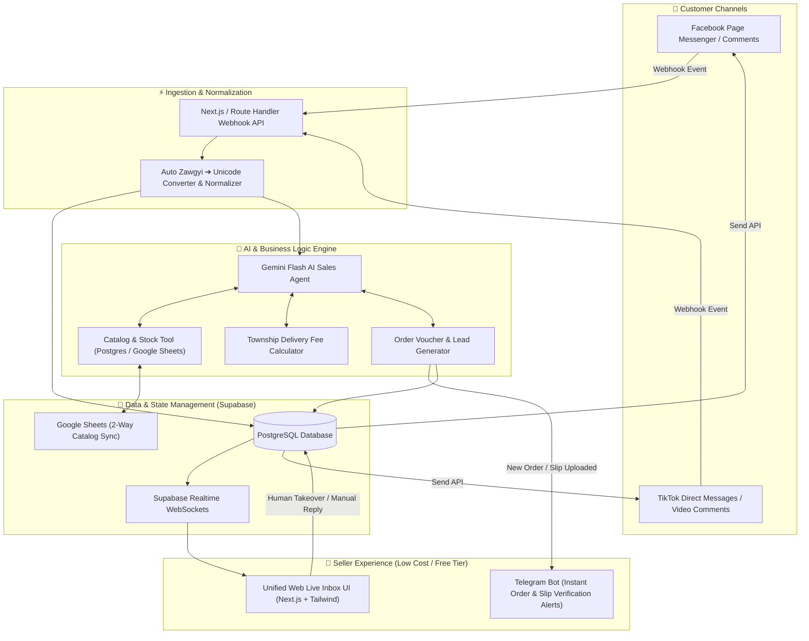

# 🚀 Myanmar AI Social Commerce Hub: Unified Facebook & TikTok Inbox

A low-cost, AI-automated social commerce platform tailored specifically for online shops in **Myanmar**, centralizing customer conversations from **Facebook Messenger** and **TikTok Shop/Direct Messages**, with intelligent Burmese-language automated selling, real-time stock/price checking via Google Sheets sync, and instant Telegram order alerts.

---

## 🏗️ 1. System Architecture Overview

---

## 🎯 2. Core Features Tailored for the Myanmar Market

| Feature | Description | Myanmar Market Fit |
| :--- | :--- | :--- |
| **Unified Multi-Channel Inbox** | Connect multiple Facebook Pages and TikTok accounts into a single live chat interface. | Eliminates switching between Meta Business Suite and TikTok app. |
| **Zawgyi & Unicode Dual Support** | Auto-detects legacy Zawgyi encoding and converts to standard Unicode before AI processing; replies in clean Unicode. | Prevents broken font errors for older customer devices. |
| **Burmese Polite Sales Tone** | System-prompted with local business etiquette (`ရှင်` / `ခင်ဗျာ`), handling colloquial phrases (`instock shi lr`, `deli bl lout ll`). | Delivers a warm, natural shop assistant persona. |
| **Google Sheets 2-Way Sync** | Live product catalog (Name, Photo, Price, Stock count, Variants) synced automatically with seller's Google Sheets. | Zero learning curve for sellers already tracking stock in Sheets. |
| **Township Delivery & Gate Calculator** | Pre-configured delivery matrices for Yangon (45+ townships), Mandalay, and regional highway express delivery gates. | Handles standard Myanmar COD and deli fee inquiries instantly. |
| **KPay / WavePay / COD Order Flow** | AI collects: Name, Phone (09-xxx), Township, Address, Payment preference; creates a draft order voucher. | Speeds up checkout and minimizes back-and-forth messaging. |
| **Instant Telegram Seller Alerts** | Sends instant push notification with customer order details & payment slip to seller's Telegram. | 100% free push alerts without costly SMS or dedicated mobile app maintenance. |
| **Seamless Human Takeover** | One-click toggle in the inbox to pause AI responses for specific customers requiring manual attention. | Ensures complex disputes or VIP customers receive personal care. |

---

## 💰 3. Ultra-Low Cost Infrastructure Breakdown

Estimated operating cost for **10 to 50 active online shops**:

| Component | Technology | Free Tier / Monthly Cost | Notes |
| :--- | :--- | :--- | :--- |
| **Web Frontend & API** | Next.js 15 (App Router) on Vercel / Cloudflare | **$0 / month** (Hobby Tier) | Unlimited edge requests for low-to-medium traffic. |
| **Database & Realtime** | Supabase (PostgreSQL + Realtime) | **$0 / month** (Free Tier: 500MB DB, 50k MAU) | Easily holds 100,000+ chats and products. |
| **AI LLM Engine** | Google Gemini 2.5 / 3.0 Flash API | **~$0.50 – $3.00 / month** | \$0.075 / 1M input tokens. Extremely affordable Burmese processing. |
| **Push Notifications** | Telegram Bot API | **$0 / month** (Unlimited Free) | Instant real-time alerts directly on seller's phone. |
| **Catalog Storage** | Google Sheets API (v4) | **$0 / month** (Free via Google Cloud Console) | Free 2-way sync using service accounts. |
| **Total Estimated Cost** | — | **< $5.00 / month** | **Near-zero overhead!** |

---

## 🛠️ 4. Step-by-Step Implementation Roadmap

- **Phase 1: Project Scaffolding & Database Setup** (Next.js 15, Tailwind, Supabase schema & migrations)
- **Phase 2: Product Catalog & Google Sheets 2-Way Sync Engine** (CRUD, Sheet webhooks, township delivery matrix)
- **Phase 3: AI Agent & Multi-Channel Webhooks** (Meta Graph API & TikTok Webhook, Gemini Flash Burmese agent)
- **Phase 4: Unified Live Inbox UI & Telegram Order Bot** (Realtime chat, human takeover switch, slip verification)
- **Phase 5: End-to-End Simulation & Deployment** (Vercel deployment, mock webhook tests)
