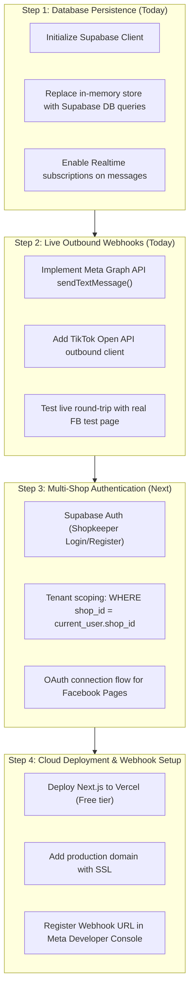

# 🔍 Production Readiness Audit & Implementation Plan

> **Executive Verdict**: 
> **No, it is not yet ready for live production with real paying customers**, but it is **~80% complete as a functional working MVP prototype**.
> 
> The core UI, Burmese NLP, delivery matrices, catalog engine, and webhook routes are built and functional. However, **4 critical production-grade blockers** must be resolved before real sellers can rely on it for actual transactions.

---

## 🚦 Current Status vs Production Readiness Scorecard

| Area | Current Status | Production Ready? | What's Missing |
| :--- | :--- | :---: | :--- |
| **Frontend & UI** | Unified Inbox, Catalog, Orders, Settings, Simulator | 🟢 **YES** (100%) | Fully responsive, functional tabs, Burmese font rendering |
| **Burmese AI Engine** | Zawgyi/Unicode normalization, slang, delivery calculator | 🟢 **YES** (90%) | Works with local fallback and Gemini Flash |
| **Township Matrix** | 45+ Townships (Yangon, Mandalay, Highway gates) | 🟢 **YES** (100%) | Accurate standard MMK pricing and COD rules |
| **Data Persistence** | In-Memory / Local mock state | 🔴 **NO** (20%) | Changes reset on restart; needs live **Supabase PostgreSQL** |
| **Outbound Messaging** | Webhooks receive inbound events | 🔴 **NO** (30%) | Inbound logged, but outbound `graph.facebook.com` send call is pending |
| **Multi-Tenancy & Auth** | Single hardcoded shop | 🔴 **NO** (10%) | No seller login; Shop A can see Shop B's chats |
| **Telegram Alerts** | Logic built & tested | 🟡 **PARTIAL** (75%) | Needs live bot token & chat ID in `.env.local` |
| **Deployment & Secrets**| Localhost dev server | 🟡 **PARTIAL** (50%) | Needs Vercel deployment and live webhook URLs |

---

## 🚨 Critical Blockers to Fix Before Launching

> [!CAUTION]
> ### Blocker 1: In-Memory Storage (Data Loss Risk)
> Currently, new products added or simulated orders created are stored in memory (`store.ts`). When the server restarts or scales, state is wiped. We must connect the existing PostgreSQL schema to **Supabase** so chats and orders persist permanently.

> [!WARNING]
> ### Blocker 2: Outbound Facebook & TikTok API Dispatch
> Currently, the webhook receivers (`/api/webhooks/facebook` and `/api/webhooks/tiktok`) receive customer messages, parse Burmese, and run the AI, but **do not dispatch the message back to Facebook Messenger**. We must add the official Graph API `POST /me/messages` call with the Page Access Token.

> [!IMPORTANT]
> ### Blocker 3: Seller Authentication & Shop Isolation
> In a SaaS platform where multiple Myanmar shops use the software, Shopkeeper A must only see their own Facebook page, catalog, and orders. We need Supabase Auth (Email or Phone/OTP) and Row Level Security (RLS).

---

## 🛠️ Step-by-Step Plan to Reach Full Production

---

## 📋 Proposed Implementation Tasks

### 1. Database Persistence Layer
- [ ] Connect `@supabase/supabase-js` using environment variables (`NEXT_PUBLIC_SUPABASE_URL` and `SUPABASE_SERVICE_ROLE_KEY`).
- [ ] Write DB repository functions in `src/lib/db.ts`:
  - `getConversations(shopId)`
  - `getMessages(conversationId)`
  - `saveMessage(message)`
  - `getProducts(shopId)`
  - `updateProductStock(productId, delta)`
  - `createOrder(order)`
- [ ] Fall back gracefully to local mock store when Supabase keys are not provided.

### 2. Live Facebook Messenger Outbound Sender
- [ ] Implement `sendFacebookMessage(recipientId, text, pageAccessToken)` in `src/lib/facebook.ts`.
- [ ] Wire the outbound call directly inside `src/app/api/webhooks/facebook/route.ts` so the customer receives the AI reply on Messenger within 1-2 seconds.

### 3. Telegram Live Dispatch Verification
- [ ] Verify Telegram alert delivery with live bot token in `src/app/api/telegram/route.ts`.

### 4. Production Environment Checklist
- [ ] Setup `.env.local` with real keys.
- [ ] Verify `npm run build` passes with zero warnings.
- [ ] Provide one-click Vercel deployment guide.

---

## ❓ Open Questions for You

> [!NOTE]
> 1. **Do you currently have a Facebook Page & Meta Developer account** ready to test real webhook integration, or are you pitching/demoing to clients first?
> 2. **Single Shop vs Multi-Tenant SaaS**: Are you deploying this for **your own shop first**, or do you want other shop owners to sign up immediately? *(If for your own shop first, we can skip multi-tenant auth and launch in 24 hours!)*
