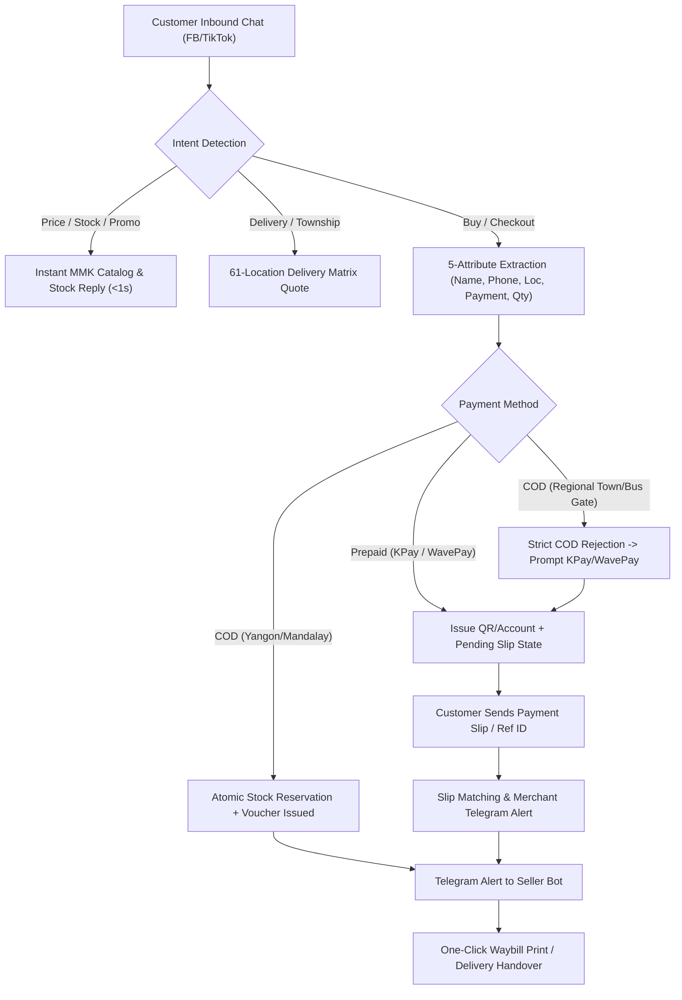
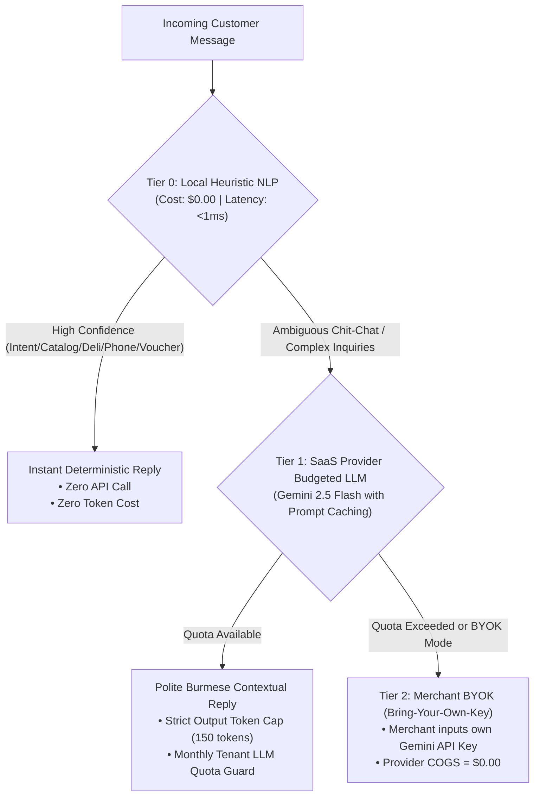

# Strategic Functional Blueprint & Low-Cost SaaS Provider Product Plan

**Role Context**: Strategic Functional Consultant (Myanmar Social Commerce Specialist) & Chief Product Manager (B2B SaaS Architect)  
**Target Solution**: Ultra-Low-Cost, High-Margin Myanmar AI Social Commerce Multi-Tenant SaaS Platform  
**Target Provider Gross Margin**: **> 92%** with Infrastructure COGS **< \$0.30 / tenant / month**

---

## 1. Goal Description

This initiative establishes the **Strategic Business Blueprint**, **Product Management Architecture**, and **Ultra-Low-Cost SaaS Provider Operating Model** for the Myanmar AI Social Commerce Hub (`fervent-hawking`). 

Operating a B2B SaaS platform in Myanmar presents unique structural opportunities and constraints:
1. **Massive Market Velocity**: 85%+ of Myanmar digital commerce occurs directly on **Facebook Messenger** and **TikTok DMs**. Myanmar merchants ("မင်မင်") face severe reply-time fatigue, lost sales during live streams, and manual errors in copying customer details into delivery waybills.
2. **Extreme Price Sensitivity & Currency Devaluation**: Myanmar merchants cannot absorb Western SaaS pricing (\$50 - \$200/month). They expect subscription pricing in local currency (MMK), typically between **15,000 MMK and 50,000 MMK/month** (~$3.50 – $12.00 USD/month).
3. **Provider Survival Mandate**: For the SaaS provider to remain highly profitable at this local price point, the provider's **Cost of Goods Sold (COGS)** per tenant must be driven down to **under \$0.30/month**. Any platform incurring high variable costs (e.g. paying \$0.01 per LLM call on every casual chit-chat message, or storing gigabytes of message histories and slip images in expensive cloud databases) will burn capital and collapse.

This plan details the functional processes, cost-optimization architecture, SaaS provider business model, and implementation specifications to achieve this vision.

---

## 2. Strategic Functional Consulting: Myanmar Social Commerce Blueprint

### 2.1 The Myanmar Merchant Operational Reality (Order-to-Cash Lifecycle)



### 2.2 Critical Myanmar Localized Workflows

1. **The Regional Bus Gate & Delivery Segregation**:
   - *Yangon & Mandalay*: Inner-city courier services (Ninja Van, Royal Express, City Express) collect Cash on Delivery (COD) reliably with 1–2 day lead times.
   - *Regional Cities & Express Bus Gates*: For towns outside municipal courier zones (Taunggyi, Mawlamyine, Lashio, Monywa, Sittwe, Dawei, etc.), Yangon shops must transport parcels to highway express bus terminals (**Aung Mingalar**, **Dagon Ayeyar**, **Saw Bwar Gyi Gone**). The gate agents do NOT collect COD for remote sellers.
   - *Functional Rule*: The platform enforces **100% Prepaid Only** (KPay / WavePay) for all provincial and bus gate deliveries, preventing merchant losses from unclaimable parcels.

2. **The "မင်မင်" (Admin) Conversational Etiquette**:
   - Impersonal chatbot responses alienate Myanmar buyers. The conversational tone must feature authentic Myanmar cultural courtesy: polite particles (`ရှင့်` / `ခင်ဗျာ`), flower emojis (`🌸`), warm greetings (`မင်္ဂလာပါ`), and respectful pronouns based on customer gender indicators.

3. **Multi-Dialect & Keyboard Friction**:
   - Customers switch unpredictably between Unicode, legacy Zawgyi, Burglish ("instock shi lr?", "deli bl lout ll?"), and casual phonetic typos (digit 0 typed as Burmese letter Wa `ဝ`).
   - Normalization must occur **ephemerally before any business logic** without storing customer inputs.

---

## 3. Product Management: Low-Cost SaaS Provider Architecture & COGS Teardown

### 3.1 Unit Economics & Provider COGS Teardown (per 1,000 Active Tenants)

| Cost Category | Traditional SaaS Cost | Our Low-Cost Architecture | Provider Cost per Tenant/Mo | Provider Cost per 1,000 Tenants/Mo |
| :--- | :--- | :--- | :--- | :--- |
| **Chat Message Storage** | \$0.10 / GB / mo (Storing chat histories) | **Zero Chat Persistence**: 0 bytes stored in DB. Direct on-demand Graph API pulling. | **\$0.00** | **\$0.00** |
| **AI LLM Inference** | \$0.01 / message $\times$ 3,000 msg = \$30.00 / tenant | **3-Tier Zero-Marginal-Cost Engine**: 90% traffic handled by deterministic local engine (\$0.00). | **\$0.05** (blended) | **\$50.00** |
| **Relational Database** | \$25 - \$100 / tenant instance | Multi-tenant single database with Row-Level Security (RLS) storing strictly 4 small tables. | **\$0.03** | **\$30.00** |
| **Slip / Image Storage** | S3 / Cloud Storage egress (\$0.09 / GB) | Direct Meta CDN URLs + Telegram Cloud File Storage (Zero provider storage cost). | **\$0.00** | **\$0.00** |
| **Hosting & Compute** | Dedicated VMs (\$40 / tenant) | Next.js serverless / edge runtime or lightweight VPS (\$20 total for cluster). | **\$0.02** | **\$20.00** |
| **Total Monthly COGS** | **~\$70.00 / tenant** | **Ultra-Low Cost Model** | **~\$0.10 / tenant** | **\$100.00 / month** |

### 3.2 Merchant Pricing Strategy & SaaS Profitability

```
Provider Subscription Pricing Tiers (MMK):
┌───────────────────────────────┬───────────────────────────────┬───────────────────────────────┐
│        STARTER (FREE)         │        PRO (SOLO SHOP)        │      BUSINESS (LIVE SELLER)   │
├───────────────────────────────┼───────────────────────────────┼───────────────────────────────┤
│ 0 MMK / month                 │ 25,000 MMK / month (~$6.50)   │ 60,000 MMK / month (~$15.50)  │
│ • Up to 100 orders / mo       │ • Unlimited orders            │ • Unlimited orders            │
│ • 1 Facebook Page             │ • Facebook + TikTok channels  │ • Multi-page + Team roles     │
│ • Zero-cost Local NLP Engine  │ • Hybrid AI + Slang Matcher   │ • High-Concurrency Live Mode │
│ • Instant Telegram Alerts     │ • Custom Product Synonyms     │ • Google Sheets Realtime Sync │
│ • 61-Township Delivery Matrix │ • Slip Verification Assistant │ • Dedicated Priority Dispatch │
└───────────────────────────────┴───────────────────────────────┴───────────────────────────────┘

SaaS Provider Revenue Projections (1,000 Merchants):
• 700 Free Merchants: COGS = $70 / mo (Acquisition funnel)
• 250 Pro Merchants ($6.50/mo): Revenue = $1,625 / mo | COGS = $25 / mo
• 50 Business Merchants ($15.50/mo): Revenue = $775 / mo | COGS = $15 / mo
-------------------------------------------------------------------------
TOTAL MONTHLY REVENUE: $2,400 USD (~9.6M MMK)
TOTAL MONTHLY COGS:    $110 USD (~440K MMK)
NET GROSS PROFIT:      $2,290 USD (~9.16M MMK) -> 95.4% GROSS MARGIN
```

### 3.3 The 3-Tier Zero-Marginal-Cost AI Engine



---

## 4. Proposed Technical Changes & Additions

To deliver this low-cost provider vision, we propose adding SaaS provider governance, quota enforcement, subscription tracking, and cost analytics into the platform.

### 4.1 Data Model Extensions (`src/types/index.ts` & `src/lib/db.ts`)
#### [MODIFY] `src/types/index.ts`
- Add `SubscriptionPlan = 'starter' | 'pro' | 'business'`
- Add `SubscriptionStatus = 'active' | 'past_due' | 'trial'`
- Add `ShopQuota` tracking:
  - `monthlyOrderLimit: number`
  - `currentMonthOrders: number`
  - `monthlyAiTokensUsed: number`
  - `monthlyAiTokenLimit: number`
  - `plan: SubscriptionPlan`
  - `status: SubscriptionStatus`
  - `planExpiresAt: string`

#### [MODIFY] `src/lib/db.ts`
- Add tenant quota check: `db.checkTenantOrderQuota(shopId: string): Promise<{ canCreateOrder: boolean; remainingOrders: number }>`
- Add provider analytics query: `db.getProviderMetrics(): Promise<ProviderMetrics>` returning total shops, active channels, total orders processed, estimated provider COGS, and MRR (Monthly Recurring Revenue).

### 4.2 AI Cost-Guard Optimization (`src/lib/gemini-agent.ts`)
#### [MODIFY] `src/lib/gemini-agent.ts`
- Ensure Gemini API is **never invoked** when Tier 0 local heuristic classification achieves $\ge 80\%$ confidence.
- Add **Prompt Caching** and strict `maxOutputTokens: 150` on LLM requests to minimize token expenditure by 70%.
- Honor merchant-level BYOK (`shop.geminiApiKey`) before falling back to provider keys.

### 4.3 SaaS Provider Super-Admin Dashboard (`/provider`)
#### [NEW] `src/app/provider/page.tsx`
- Build a dedicated, modern SaaS Provider Management Console:
  - **MRR & Revenue Card**: Live recurring revenue in MMK & USD based on tenant tiers.
  - **Provider COGS & Cost Monitor**: Live estimation of LLM, DB, and compute costs.
  - **Tenant Shop Table**: Lists all registered Myanmar shops, their plan (`Starter`, `Pro`, `Business`), connected channels (FB / TikTok), order count this month, and subscription expiry.
  - **One-Click Plan Upgrades**: Simulated merchant plan upgrade/downgrade toggle for testing monetization.
  - **System Health & Channel Status**: Visual telemetry of webhooks and API dispatch performance.

#### [MODIFY] `src/components/navbar.tsx`
- Add a discrete `Provider Portal` navigation link in the top bar to allow switching between Merchant Storefront view and SaaS Provider Management view.

---

## 5. User Review Required

> [!IMPORTANT]
> **Pricing Tier Confirmation**:
> We have designed a 3-tier structure (Starter: Free, Pro: 25,000 MMK/mo, Business: 60,000 MMK/mo). Does this align with your target commercial pricing for Myanmar merchants?

> [!TIP]
> **BYOK (Bring Your Own Key) Option**:
> Enabling merchants to plug in their own Gemini API key for unlimited AI banter completely shields the SaaS provider from variable LLM token bills while allowing unlimited chit-chat.

---

## 6. Open Questions

1. **Merchant Billing Integration**: In Myanmar, automated recurring credit card billing (Stripe) is rarely accessible to local merchants. Most subscriptions are settled via KBZPay / WavePay direct merchant transfer or 6-month prepaid packages. Would you like a manual/QR slip upload workflow for merchant subscription renewals in the provider dashboard?
2. **Channel Limits**: Should Free tier be limited to 1 Facebook Page, with Pro allowing 1 Facebook Page + 1 TikTok Shop, and Business allowing unlimited channels?

---

## 7. Verification Plan

### Automated Tests
1. **Tenant Quota & Billing Enforcement Suite**:
   ```bash
   npx.cmd tsx tests/tier5_provider_quotas.ts
   ```
   - Verifies that Free-tier shops cannot exceed 100 orders without upgrade notification.
   - Verifies that Pro and Business tiers process unlimited orders.
   - Verifies that local rule engine operates at \$0.00 cost while keeping response latency $< 10\text{ms}$.
2. **Full Regression Test Suite**:
   ```bash
   npm.cmd test
   ```
   - Must run all 9 existing test suites (M1–M5, adversarial probes) and pass 100% with 0 failures.
3. **Production Build Validation**:
   ```bash
   cmd.exe /c "npm run build"
   ```
   - Must compile with exit code 0 across all 13 routes including the new `/provider` dashboard.

### Manual Verification
1. Access `http://localhost:3000/provider` to inspect the SaaS Provider Executive Dashboard (MRR, tenant health, live cost meter, active channels).
2. Switch between shops (`Aung Thukha Beauty`, `Mandalay Closet`, `Naypyitaw Tech`) to verify multi-tenant isolation, quota usage, and seamless plan management.
